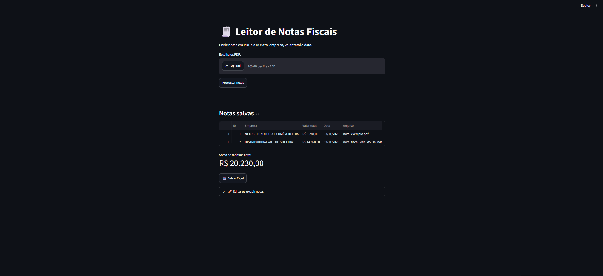

# 🧾 Leitor de Notas Fiscais com IA

Sistema que recebe notas fiscais em PDF (de escaneadas e amassadas a digitais),
usa IA de visão para extrair **empresa, valor total e data** e salva tudo,
já validado e padronizado, em um banco SQL.



## Como funciona

PDF → imagem (PyMuPDF) → leitura com IA (Gemini) → validação → SQLite → interface (Streamlit) → Excel

## Funcionalidades

- Upload de vários PDFs de uma vez
- Leitura de notas de qualidade ruim com IA de visão
- Validação antes de gravar (valor positivo, data real, empresa preenchida)
- Padronização de formatos (ex.: `1.234,56` vira `1234.56`)
- Proteção contra duplicatas em duas camadas: hash do arquivo (nem chama a IA)
  e conferência de empresa + valor + data
- Novas tentativas e modelo reserva quando a API falha (erros 503 e 429)
- Edição e exclusão de notas direto na interface
- Exportação para Excel formatado (valores em R$, datas, filtros, total e resumo por empresa)

## Tecnologias

Python · PyMuPDF · Google Gemini API · SQLite · Streamlit · pandas · openpyxl

## Como rodar

1. Clone o repositório e entre na pasta
2. Instale as dependências:
   ```bash
   python -m pip install -r requirements.txt
   ```
3. Crie uma chave em [Google AI Studio](https://aistudio.google.com) e defina a variável de ambiente `GEMINI_API_KEY`
4. Rode o app:
   ```bash
   python -m streamlit run app.py
   ```

## Estrutura

| Arquivo              | Função                                                             |
| -------------------- | ------------------------------------------------------------------ |
| `app.py`             | Interface web (upload, tabela, edição e download)                  |
| `pdf_para_imagem.py` | Converte as páginas do PDF em imagens                              |
| `leitor_ia.py`       | Envia a imagem ao Gemini e recebe os dados em JSON                 |
| `validacao.py`       | Confere e padroniza os dados antes de salvar                       |
| `banco.py`           | Operações no SQLite (inserir, listar, editar, excluir, duplicatas) |
| `exportar_excel.py`  | Gera a planilha formatada                                          |

## Limitações conhecidas

- Duas compras diferentes na mesma loja, no mesmo dia e com o mesmo valor são tratadas como duplicata
- O plano gratuito da API tem limite diário de requisições
- A IA pode errar em notas muito ilegíveis (por isso existem a validação e a edição manual)

## Próximos passos

- Filtro por período e por empresa
- Gráfico de gastos por empresa e por mês
- Mais campos (CNPJ, itens da nota)

## Autor

[Seu nome] · [LinkedIn](https://www.linkedin.com/in/SEU-PERFIL)
